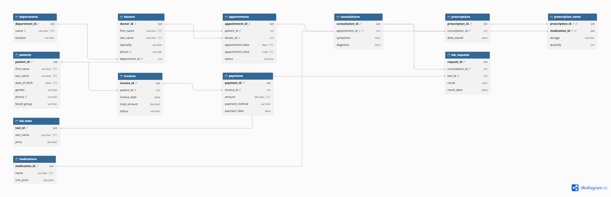

# Portfolio 1: Database Design and Modelling

## Case study
CareBridge Specialist Clinic, Abuja (simulated). See [case-study.md](../case-study.md).

## Files
| File | Purpose |
|---|---|
| `carebridge-clinic-erd.png` | ER diagram (exported from dbdiagram.io) |
| `carebridge-clinic-erd.dbml` | Source code of the ER diagram |
| `carebridge-schema.sql` | PostgreSQL schema: tables, keys and constraints |
| `carebridge-sample-data.sql` | Generated sample data (5,000 patients, 20,000 appointments) |
| `screenshots/` | Evidence of the schema and data being created |

## ER diagram

The design has 12 entities. Key relationships:
- One department has many doctors; one doctor has many appointments.
- One patient has many appointments and many invoices.
- One appointment has at most one consultation (one-to-one, enforced by `UNIQUE`).
- Prescriptions and medications are many-to-many, resolved by the junction table `prescription_items`.
- One consultation can have many lab requests; one invoice can have many payments (part-payments).

## Keys and constraints
| Constraint | Example | Why |
|---|---|---|
| Primary key | `patient_id` (identity) | Uniquely identifies each row |
| Composite primary key | `(prescription_id, medication_id)` | Same drug cannot appear twice on one prescription |
| Foreign key | `appointments.patient_id` | Cannot book for a patient who does not exist |
| `UNIQUE` | `(doctor_id, appointment_date, appointment_time)` | Prevents double-booking a doctor |
| `CHECK` | `blood_group IN ('A+', ...)`, `quantity > 0` | Rejects invalid values |
| `ON DELETE RESTRICT` | patients, doctors | Protects medical and billing history |
| `ON DELETE CASCADE` | consultation → prescriptions | Child records removed with their parent |

## Normalisation
The schema is normalised to **Third Normal Form (3NF)**.

**First Normal Form (1NF):** every column holds a single, atomic value and every table has a primary key. For example, a prescription's medicines are not stored as a list such as "Paracetamol, Amoxicillin" in one column; each medicine is a separate row in `prescription_items`.

**Second Normal Form (2NF):** no non-key column depends on only part of a composite key. The only composite key is `(prescription_id, medication_id)`. `dosage` and `quantity` depend on both parts, while the medicine's `name` and `unit_price` depend only on `medication_id`, so they are stored in `medications`, not repeated in every prescription item.

**Third Normal Form (3NF):** no non-key column depends on another non-key column. A doctor's department name is stored once in `departments`, not in `doctors`, because it depends on `department_id` rather than on the doctor. Likewise, patient details are not repeated in `appointments`, and test prices live in `lab_tests`.

**Deliberate trade-off:** `invoices.total_amount` could be calculated from consultation, medication and test charges. It is stored to keep a fixed record of what was billed at that time and to avoid recalculating totals for every report.

## How to run

    createdb carebridge_clinic
    psql -d carebridge_clinic -f carebridge-schema.sql
    psql -d carebridge_clinic -f carebridge-sample-data.sql

## Evidence

